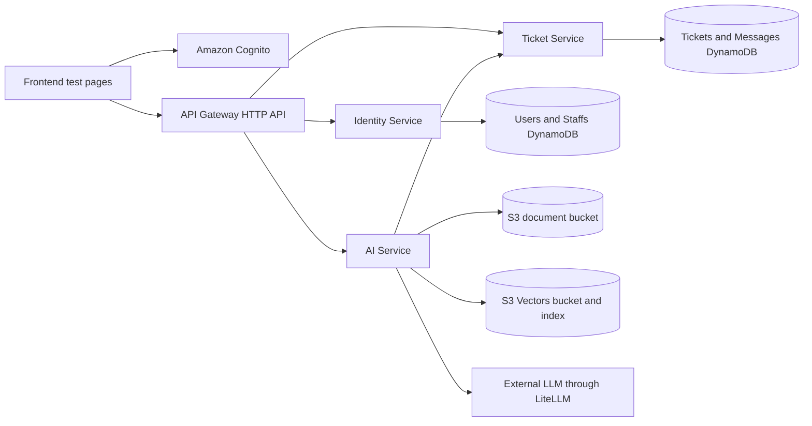

# Sentra

Sentra is a cloud-based support platform that combines authenticated user profiles, ticket management, and an AI assistant that answers questions from indexed company documents and retrieves the authenticated user's tickets.

The project contains three FastAPI services:

- **Identity Service** manages user profiles and administrator-controlled staff accounts using Amazon Cognito and DynamoDB.
- **Ticket Service** manages support tickets, assignment workflows, and ticket messages.
- **AI Service** processes PDF company documents, stores embeddings in Amazon S3 Vectors, uses LiteLLM for responses, and calls the Ticket Service for user-scoped ticket information.

Terraform provisions the AWS deployment with ECS/Fargate, private networking, API Gateway, Cognito, DynamoDB, S3, S3 Vectors, Secrets Manager, and CloudWatch Logs.

## Architecture



API Gateway validates Cognito JWTs and forwards the authenticated token subject as `X-User-Id`, which is the identity header expected by the services.

## Repository Layout

```text
services/identity/    User profiles and staff administration
services/ticket/      Ticket and message workflows
services/ai/          Document ingestion, vector search, and AI responses
frontend-test/        Static Cognito login and API test pages
infrastructure/       Terraform modules and AWS deployment configuration
```

## Requirements

- Python 3.12 or newer
- `pip` and a virtual environment
- AWS CLI credentials for AWS-backed local execution or deployment
- Terraform 1.6 or newer for infrastructure work
- Docker, if building service images
- A Groq API key for AI responses

## Run Services Locally

Run each service from its own directory so the local `app` package is importable.

### Identity Service

```bash
cd services/identity
python -m venv .venv
source .venv/bin/activate
python -m pip install -r requirements.txt
python -m uvicorn app.main:app --host 0.0.0.0 --port 8000
```

### Ticket Service

```bash
cd services/ticket
python -m venv .venv
source .venv/bin/activate
python -m pip install -r requirements.txt
python -m uvicorn app.main:app --host 0.0.0.0 --port 8000
```

### AI Service

```bash
cd services/ai
python -m venv .venv
source .venv/bin/activate
python -m pip install -r requirements.txt
python -m uvicorn app.main:app --host 0.0.0.0 --port 8000
```

Each service exposes `GET /health` and `GET /ready`.

## Configuration

Services load environment variables from the process environment or a local `.env` file.

Common settings:

```text
AWS_REGION
DYNAMODB_ENDPOINT_URL
USERS_TABLE_NAME
STAFFS_TABLE_NAME
TICKETS_TABLE_NAME
MESSAGES_TABLE_NAME
```

Identity settings:

```text
COGNITO_USER_POOL_ID
COGNITO_CLIENT_ID
COGNITO_CLIENT_SECRET
DYNAMODB_USER_TABLE_NAME
DYNAMODB_STAFF_TABLE_NAME
```

AI settings:

```text
S3_BUCKET_NAME=sentra-ai-bucket
S3_BUCKET_INDEX=sentra-ai-bucket-index
S3_DOC_STORAGE_BUCKET_NAME=sentra-ai-doc-bucket
EMBEDDING_MODEL=sentence-transformers/all-MiniLM-L12-v2
GROQ_API_KEY
STAFF_TABLE_NAME
TICKET_SERVICE_URL
```

Do not commit credentials, API keys, `.env` files, Terraform state, or `terraform.tfvars`.

## Run Tests

Run tests from the relevant service directory:

```bash
cd services/identity
python -m pytest tests -v
```

```bash
cd services/ticket
python -m pytest tests -v
```

```bash
cd services/ai
python -m pytest tests -v
```

The tests use FastAPI's `TestClient` and mocks where service behavior does not require live AWS resources.

## Frontend Test Pages

The `frontend-test` directory contains static Cognito login, signup, password-change, and API test pages. Configure the Cognito region, Cognito app client ID, and deployed API Gateway URL in `frontend-test/auth.js` before using them.

Serve the pages locally with:

```bash
cd frontend-test
python -m http.server 8080
```

Then open `http://localhost:8080/login.html`.

## Terraform Deployment

The Terraform configuration is in [`infrastructure`](infrastructure). It provisions:

- A VPC with public and private subnets and optional single or multi-AZ NAT gateways.
- Cognito User Pool, SPA client, and pre-signup Lambda.
- Users, Staffs, Tickets, and Messages DynamoDB tables.
- A shared ECS cluster with separate Fargate services for Identity, Ticket, and AI.
- Private ECS tasks and internal ALBs connected through API Gateway VPC Link.
- Cognito JWT authorization on API Gateway routes.
- An encrypted document bucket named `sentra-ai-doc-bucket` by default.
- An S3 Vectors bucket named `sentra-ai-bucket` and index named `sentra-ai-bucket-index` by default, using 384-dimensional float32 vectors.
- CloudWatch logging and Secrets Manager integration for sensitive values.

### Configure Terraform

```bash
cd infrastructure
cp terraform.tfvars.example terraform.tfvars
```

Review `terraform.tfvars` and set the AWS region, Cognito callback/logout URLs, container images, S3 Vectors settings, and secret values. The file is ignored by Git and must not contain credentials committed to the repository.

### Validate and Plan

```bash
terraform fmt -recursive
terraform init
terraform validate
terraform plan
```

### Apply

After reviewing the plan:

```bash
terraform apply
```

Terraform outputs the Cognito identifiers, API Gateway endpoint, ECS service names, ALB DNS names, DynamoDB table names, and storage resource identifiers. Use those outputs to configure the frontend and service integrations.

### Destroy

```bash
terraform destroy
```

Review deletion protection and data-retention settings before destroying any environment.

## Docker

Each service includes a Dockerfile and listens on port `8000`. The configured deployment images are:

```text
dgclasher/sentra-identity-service:latest
dgclasher/sentra-ticket-service:latest
dgclasher/sentra-ai-service:latest
```

Build images locally with:

```bash
docker build -t sentra-identity-service services/identity
docker build -t sentra-ticket-service services/ticket
docker build -t sentra-ai-service services/ai
```

## API Authentication

The deployed API uses Cognito JWT authentication at API Gateway. Services receive the authenticated user's Cognito subject through `X-User-Id`; callers should not supply identity through query parameters or request bodies.